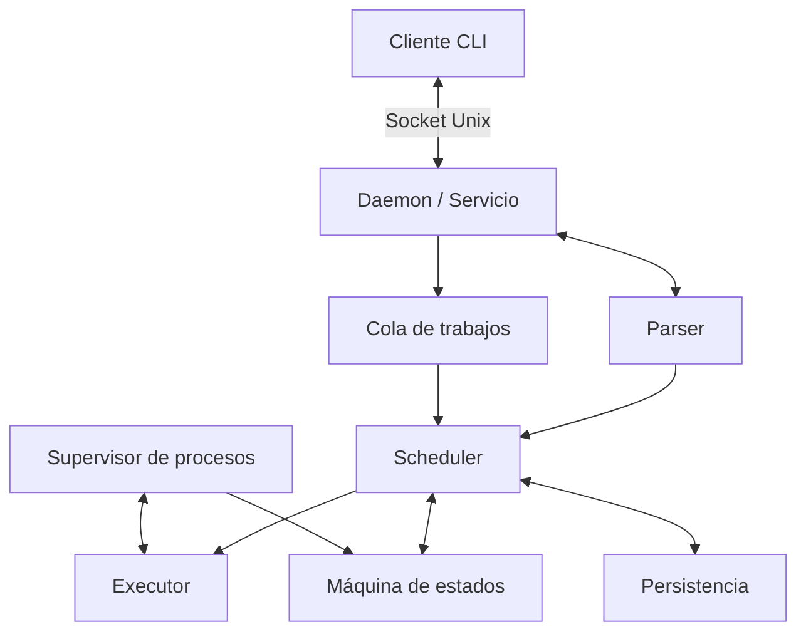
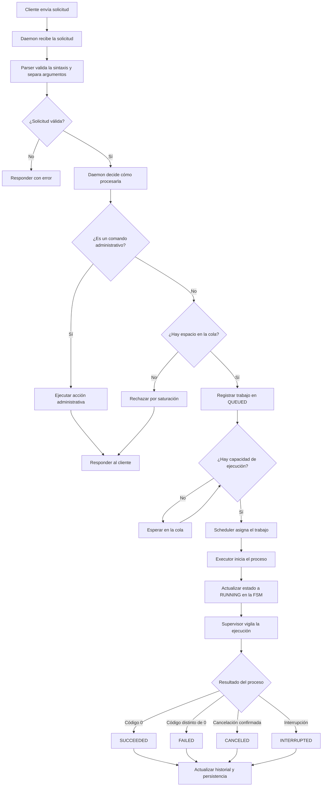

# Arquitectura

## 1. Objetivo

Documentar la arquitectura de speedyG, incluyendo la cola de trabajos, el scheduler, el supervisor de procesos, la máquina de estados, la comunicación entre componentes y el registro de resultados.

La arquitectura se basa en el patrón **Event Loop + FSM**, seleccionado en ADR-02.

## 2. Diagrama de componentes

## 3. Flujo de una solicitud

## 4. Responsabilidades de los componentes 

| Componente | Responsabilidad |
|---|---|
| Daemon | Mantener el servicio activo, recibir solicitudes mediante el socket Unix y coordinar su procesamiento |
| Cliente CLI | Enviar solicitudes y consultar resultados mediante el socket Unix |
| Parser | Validar la sintaxis y separar el comando de sus argumentos |
| Cola | Mantener los trabajos pendientes de ejecución |
| Scheduler | Asignar trabajos a la ejecución respetando el límite de concurrencia |
| Executor | Iniciar los comandos y obtener sus resultados |
| Supervisor de procesos | Vigilar la ejecución, gestionar la cancelación y recolectar los procesos finalizados |
| Máquina de estados (FSM) | Controlar las transiciones válidas de cada trabajo |
| Persistencia | Conservar el historial y permitir recuperar la información necesaria después de un reinicio |

## 5. Modelo de estados

- `QUEUED`: esperando capacidad de ejecución.
- `RUNNING`: proceso en ejecución.
- `SUCCEEDED`: finalizó correctamente.
- `FAILED(i32)`: finalizó con un código de salida distinto de cero.
- `CANCELED`: ejecución cancelada.
- `INTERRUPTED`: ejecución interrumpida, por ejemplo, durante la recuperación tras un reinicio del servicio.

Las transiciones deben validarse mediante la FSM. Los estados terminales no deben volver a estados anteriores ni cambiar a otro estado terminal

Cuando el servicio se reinicia, los trabajos que estaban en `RUNNING`deben cambiarse a `INTERRUPTED`si el servicio ya no controla sus procesos. Los trabajos pendientes y los resultados terminales deben conservarse de acuerdo con la estrategia de persistencia.

## 6. Comunicación e IPC 

El cliente se comunica con el servidor mediante un socket Unix.

La estrategia interna de coordinación entre el servidor, el scheduler y los procesos deben mantener consistente el estado  de los trabajos y evitar que varias operaciones modifiquen el mismo estado de manera incompatible

La elección entre un Mutex compartido y un unico task propietario del estado con canales MPSC queda pendiente de la decisión A2-02

También queda pendiente definir en A2-02 la estrategia definitiva de creación de procesos, gestión de grupos de procesos (PGID) y recolección de procesos hijos

## 7. Señales y supervisión de procesos

Para cancelar un trabajo, la estrategia definida en A2-03 contempla:

1. Enviar `SIGTERM` al grupo de procesos del trabajo
2. Esperar un tiempo configurable para permitir el cierre ordenado
3. Si el proceso no termina, enviar `SIGKILL`
4. Recolectar los procesos hijos finalizados y actualizar el estado del trabajo

El grupo de procesos debe identificarse y validarse correctamente para evitar afectar procesos ajenos al trabajo

El cierre del servicio debe coordinar la recepción de nuevas solicitudes, la supervisión de los procesos activos y la conservación de la información necesaria para la recuperación

## 8. Estrategia de errores

| Situación | Comportamiento esperado |
|---|---|
| Solicitud inválida | Rechazarla e informar el motivo |
| Cola llena | Rechazar el nuevo trabajo e informar la saturación |
| Error durante la ejecución | Registrar el código de salida y marcar el trabajo como `FAILED`|
| Cancelación solicitada | Intentar terminar el grupo de procesos y escalar a `SIGKILL` si es necesario |
| Reinicio del servicio | Mandar a `INTERRUPTED` los trabajos en ejecución |
| Error de comunicación o persistencia | Registrar el error e informar cuando sea posible, evitando presentar información no confirmada como válida |

## 9. Modelo básico de amenazas (RNF-16)

| Amenaza | Riesgo | Mitigación prevista |
|---|---|---|
| Acceso desde fuera de la red privada | Uso del servicio por personas fuera de la red autorizada | Restringir el acceso al servicio a los equipos conectados a la VPN |
| Cliente no autorizado dentro de la VPN | Ejecución de comandos sin permiso | El acceso a la VPN limita la exposición del servicio, pero no garantiza por sí solo la autorización de cada cliente |
| Saturación de recursos | Acumulación de trabajos o exceso de procesos | Limitar la capacidad de la cola y la cantidad de trabajos ejecutados simultáneamente |
| Cancelación incorrecta | Terminar procesos ajenos al trabajo | Verificar que las señales se dirijan únicamente a los procesos del trabajo correspondiente |
| Caída o reinicio del servicio | Estados inconsistentes o pérdida del historial |  Conservar el historial mediante persistencia y marcar como `INTERRUPTED` los trabajos que estaban en `RUNNING` y cuyo proceso ya no se controla tras el reinicio |

## 10. Límites conocidos

- El límite de trabajos pendientes en la cola es de tres; el límite de procesos ejecutándose simultáneamente es independiente.
- Las solicitudes duplicadas se consideran trabajos independientes, por lo que un reintento puede ejecutar el mismo comando más de una vez.
- `SIGKILL` termina un proceso sin permitirle realizar su cierre ordenado.
- Conservar el historial indefinidamente puede aumentar el consumo de almacenamiento.
- La recuperación tras un reinicio depende de la estrategia de persistencia implementada.
- La coordinación interna, la estrategia definitiva de creación de procesos y la gestión de PGID deben concretarse en A2-02.

## 11. Relación con otras decisiones

- **ADR-02:** selección de Event Loop + FSM.
- **A2-01:** modelo de estados y transiciones de los trabajos.
- **A2-02:** coordinación interna, creación y supervisión de procesos.
- **A2-03:** cancelación, manejo de duplicados y límites de la cola.