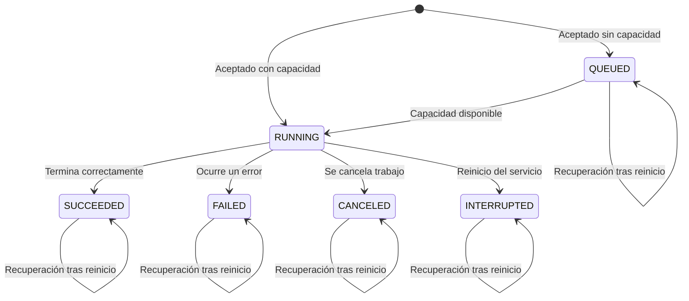

# Máquina de estados de los trabajos

## 1. Objetivo 

Definir los estados posibles de un trabajo, las transiciones permitidas y las acciones asociadas para evitar estados inconsistentes o regresiones durante la ejecución y recuperación del servicio.

## 2. Estados del trabajo

| Estado | Descripción |
|---|---|
| `QUEUED` | El trabajo fue aceptado, pero espera disponibilidad para ejecutarse |
| `RUNNING` | El trabajo se encuentra en ejecución y bajo el control del servicio |
| `SUCCEEDED` | El trabajo terminó correctamente |
| `FAILED` | El trabajo terminó con un error |
| `CANCELED` | El trabajo fue cancelado |
| `INTERRUPTED` | El trabajo estaba en ejecución, pero su ejecución fue interrumpida por el reinicio del servicio |

## 3. Tabla de transiciones

| Estado actual | Evento/condición | Estado siguiente | Acción |
|---|---|---|---|
| Inicio | Trabajo aceptado, sin capacidad disponible | `QUEUED` | Esperar en cola |
| Inicio | Trabajo aceptado, capacidad disponible | `RUNNING` | Iniciar trabajo |
| `QUEUED` | Hay capacidad disponible | `RUNNING` | Iniciar trabajo |
| `RUNNING` | Termina correctamente el trabajo | `SUCCEEDED` | Guardar resultado, libera capacidad |
| `RUNNING` | Ocurre un error | `FAILED` | Guardar error, libera capacidad |
| `RUNNING` | Se cancela trabajo | `CANCELED` | Guardar cancelación, libera capacidad |
| `RUNNING` | El servicio se reinicia, el trabajo estaba en ejecución | `INTERRUPTED` | Registrar la interrupción, liberar la capacidad reservada |
| `QUEUED` | El servicio se reinicia | `QUEUED` | Restaurar el trabajo en la cola |
| `SUCCEEDED` | El servicio se reinicia | `SUCCEEDED` | Conservar el resultado |
| `FAILED` | El servicio se reinicia | `FAILED` | Conservar el error |
| `CANCELED` | El servicio se reinicia | `CANCELED` | Conservar la cancelación |
| `INTERRUPTED` | El servicio se reinicia | `INTERRUPTED` | Conservar el estado de interrupción |

## 4. Diagrama de estados

## 5. Transiciones no permitidas 

Las transiciones que no aparecen como permitidas en la tabla, deberán rechazarse explícitamente

No se permiten:

- `SUCCEEDED` -> `RUNNING`
- `SUCCEEDED` -> `QUEUED`
- `SUCCEEDED` -> `INTERRUPTED`
- `SUCCEEDED` -> `FAILED`
- `SUCCEEDED` -> `CANCELED`
- `FAILED` -> `RUNNING`
- `FAILED` -> `QUEUED`
- `FAILED` -> `SUCCEEDED`
- `FAILED` -> `INTERRUPTED`
- `FAILED` -> `CANCELED`
- `CANCELED` -> `RUNNING`
- `CANCELED` -> `QUEUED`
- `CANCELED` -> `INTERRUPTED`
- `CANCELED` -> `FAILED`
- `CANCELED` -> `SUCCEEDED`
- `INTERRUPTED` -> `RUNNING`
- `INTERRUPTED` -> `QUEUED`
- `INTERRUPTED` -> `FAILED`
- `INTERRUPTED` -> `SUCCEEDED`
- `INTERRUPTED` -> `CANCELED`
- `QUEUED` -> `SUCCEEDED`
- `QUEUED` -> `FAILED`
- `QUEUED` -> `INTERRUPTED`
- `RUNNING` -> `QUEUED`

Los estados `SUCCEEDED`, `FAILED`, `CANCELED`, `INTERRUPTED` son terminales, una vez alcanzados, no podrán cambiar a otro estado

