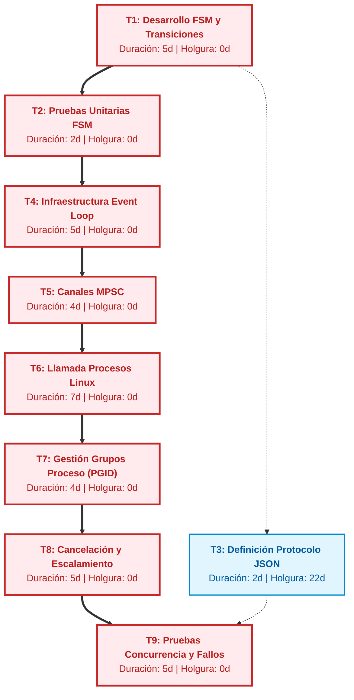

# Cronograma de desarrollo SpeedyG
El archivo se llama cronograma pero tecnicamente es un roadmap de ruta critica :)

| ID  | Tarea   | Dependencia | Duración (en días) |
|:--- |:---------------:|:-------:|:---:|
|1    | Desarrollo FSM y sus transiciones | - | 5 |
|2    | Pruebas unitarias FSM | 1 | 2 |
|3    | Definición de Protocolo JSON | 1 | 2 |
|4    | Infraestructura del Event Loop | 2 | 5 |
|5    | Canales de Comunicación MPSC | 4 | 4 |
|6    | Llamada de Procesos Linux | 5 | 7 |
|7    | Gestión de Grupos de Proceso | 6 | 4 |
|8    | Lógica de Cancélación y Escalamiento | 7 | 5 |
|9    | Pruebas de Concurrencia e Inyección de Fallos | 3, 8 | 5 |

# Roadmap de Desarrollo Técnico - SpeedyG (versión grafica)

# Cronograma Avance 2:

**Avance 02:** concurrencia, persistencia y robustez.

**Technical Review 2:** presentación presencial, **martes 3 de noviembre de 2026**, obligatoria para todos.
**Congelamiento de código (propuesto):** **lunes 2 de noviembre, 18:00**. Después solo se aceptan correcciones de documentación y evidencia.

## Roles por componente técnico

| Integrante | Rol | Parte técnica que defiende |
| --- | --- | --- |
| Uriel | Low level | Procesos, señales y cancelación (A2-08) |
| Carolina | State Manager | FSM y transiciones (A2-01); ADR de cancelación (A2-03); arquitectura (A2-04) |
| Paola | Networking, CLI y backend | Concurrencia en el backend (A2-02, A2-11); guías (A2-29); cronograma (A2-30) |
| Erick | DevOps | Plan de verificación, scripts TC y matriz |

## Mapa de issues del avance

| Issue | ID | Título | Responsable | Prioridad | Depende de | Estado | RF/RNF clave |
| --- | --- | --- | --- | --- | --- | --- | --- |
| #55 | A2-01 | Modelo de estados y transiciones validadas | Carolina | Crítica | — | Cerrado | RF-06, RF-07, RF-13, RNF-27, RNF-31 |
| #56 | A2-02 | ADR de concurrencia y modelo de ejecución | Paola | Alta | A2-01 | Cerrado | RF-03, RF-04, RF-05, RNF-07, RNF-27, RNF-30, RNF-34 |
| #57 | A2-03 | ADR de cancelación, escalamiento, duplicados y saturación | Uriel | Alta | A2-01 | Cerrado | RF-10, RF-25, RF-26, RF-27, RF-30, RNF-27, RNF-29, RNF-34 |
| #58 | A2-04 | Actualizar documento de arquitectura | Carolina | Alta | A2-01, A2-02, A2-03 | Cerrado | RNF-16, RNF-17, RNF-18 |
| #59 | A2-05 | Cola acotada con rechazo | Carolina | Crítica | A2-01, A2-03, A2-14 | Cerrado | RF-03, RF-23, RF-25, RNF-21, RNF-29 |
| #60 | A2-06 |  Scheduler con límite de concurrencia | Carolina | Crítica | A2-02, A2-05, A2-14 | Cerrado | RF-04, RF-05, RNF-04, RNF-07 | 
| #61 | A2-07 | Tiempos, código de salida/señal y filtro por estado | Uriel | Alta | A2-01 | Abierto | RF-06, RF-07, RF-08, RF-09 |
| #62 | A2-08 | Cancelación real en cola y en ejecución | Uriel | Crítica | A2-01, A2-03, A2-06 | Abierto | RF-10, RNF-27, RNF-30 |
| #63 | A2-09 | Escalamiento para trabajos que no terminan | Uriel | Alta | A2-03, A2-08, A2-12, A2-14 |  Abierto | RF-30, RNF-30 |
| #64 | A2-10 | Detección de terminación inesperada del hijo | Uriel |  Crítica | A2-01, A2-06, A2-07 | Abierto | RF-29, RNF-09, RNF-30
| #65 | A2-11 | Solicitudes concurrentes y duplicadas | Paola | Crítica | A2-03, A2-08 | Abierto | RF-26, RF-27, RNF-08, RNF-27 |
| #66 | A2-12 | Bitácora de eventos | Paola | Alta | A2-14 | Abierto | RF-14, RF-23, RNF-15, RNF-22 |
| #67 | A2-13 | Cierre controlado y liberación de recursos | Uriel | Crítico | A2-06, A2-08, A2-10 | Abierto | RF-15, RNF-25, RNF-30, RNF-33 |
| #68 | A2-14 |  Configuración del servicio | Erick / Paola | Alta | - | Cerrado | RF-16, RNF-18 |
| #69 | A2-15 | Infraestructura de verificación | Erick | Crítica | A2-14 | Cerrado | RNF-02, RNF-03, RNF-20, RNF-33 |
| #70 | A2-16 | Actualizar CI (GitHub Actions) | Erick | Alta | A2-15, A2-23 |Cerrado | RNF-02, RNF-19, RNF-20 |
| #71 | A2-17 | TC de cola y concurrencia (TC-002, TC-016) | Erick | Crítica | A2-15;tras A2-05 y A2-06 | Abierto | RF-03, RF-05, RF-23, RF-25, RNF-04, RNF-07, RNF-29 |
| #72 | A2-18 | TC de estados, consulta y listado (TC-003, TC-004) | Erick | Alta | A2-15; tras A2-07 | Abierto | RF-06, RF-07, RF-08, RF-09, RNF-05 |
| #73 |  A2-19 | TC de cancelación, concurrentes y duplicados (TC-005, TC-017, TC-018) | Erick | Crítica | A2-15; tras A2-08 y A2-11 | Abierto | RF-10, RF-26, RF-27, RNF-27 |
| #74 |  A2-20 | TC de procesos hijos (TC-008, TC-020, TC-021) | Erick | Crítica | A2-15; tras A2-09 y A2-10 | Abierto | RF-29, RF-30, RNF-08, RNF-09, RNF-30 |
| #75 | A2-21 | TC de cierre y recursos (TC-009, TC-024) | Erick | Alta | A2-15; tras A2-13 | Abierto | RF-15, RNF-25, RNF-30, RNF-33 |
| #76 |  A2-22 | TC dependientes de tareas asignadas a otros (TC-006, TC-007, TC-022, RNF-06) | Erick | Media | A2-15 | Abierto | RF-11, RF-12, RF-13, RNF-06, RNF-10, RNF-11, RNF-28, RNF-31 |
| #77 | A2-23 | run-all.sh y evidencia de concurrencia y recuperación | Erick | Alta | A2-15, A2-17, A2-19; de A2-22 | Abierto | RF-05, RF-10, RF-13, RNF-04, RNF-10, RNF-20, RNF-30, RNF-31 |
| #78 | A2-24 | Plan de verificación y matriz de trazabilidad | Paola / Erick | Alta | A2-15, A2-23 |Abierto | Todos del avance |
| #79 | A2-25 | Verificación independiente de PR | Todos | Media | A2-16 | Abierto | RNF-20 | 
| #80 | A2-26 | Incidente técnico con regresión | Uriel / Erick | Alta | A2-19 o A2-20, A2-23 | Abierto | RNF-27, RNF-30, RNF-34 |
| #81 | A2-27 | Registro de riesgos | Paola | Media | A2-02, A2-03 | Abierto | RNF-34 | 
| #82 | A2-28 | AI-LOG | Paola / Uriel / Erick | Media | - | Abierto | - | - | 
| #83 | A2-29 | Guías técnica y de usuario | Paola | Alta | A2-04, A2-14 | Abierto | RF-16, RF-17, RNF-18, RNF-23 |
| #84 | A2-30 | Cronograma e issues del avance | Paola | Media | — | Abierto | N/A (gestión) |

## Cobertura de RF/RNF clave por issue

| Requisito | Issue(s) | Caso(s) de prueba |
| --- | --- | --- |
| RF-03, RF-04, RF-05, RNF-07 | A2-02, A2-05, A2-06 | TC-001, TC-002, TC-016 |
| RF-06, RF-07, RF-13, RNF-31 | A2-01, A2-07 | Pruebas unitarias de transiciones; TC-003, TC-006, TC-007 |
| RF-10, RNF-30 | A2-03, A2-08, A2-09 | TC-005, TC-021 |
| RF-25, RF-30, RNF-29 | A2-03, A2-05, A2-09 | TC-016, TC-021 |
| RF-26, RF-27, RNF-08, RNF-27 | A2-03, A2-11 | TC-017, TC-018 |
| RF-16, RF-17, RNF-18, RNF-23 | A2-14, A2-29 | Prueba con persona ajena |
| RF-11, RF-12, RF-14, RF-15, RF-24, RNF-05, RNF-06, RNF-09, RNF-10, RNF-11, RNF-28, RNF-31, RNF-33 | A2-07, A2-10, A2-12, A2-13, A2-22, A2-23 | TC-004, TC-006, TC-007, TC-008, TC-009, TC-022, TC-024 |

*Minuta 3:* Se realizara un día antes de la presentación como un punto de revisión para la presentación.
